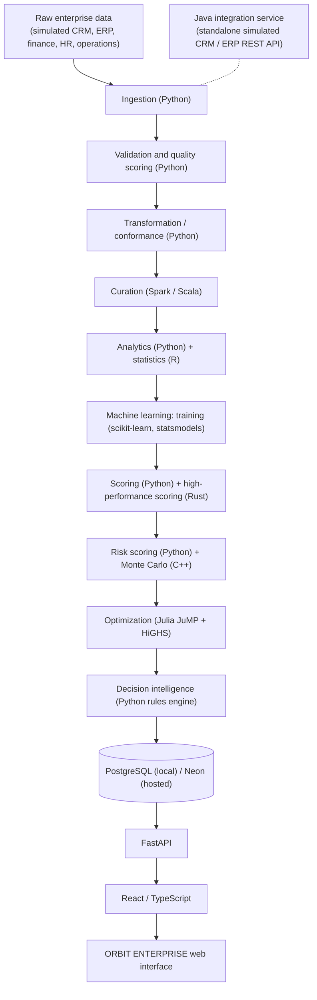

<p align="center">
  
</p>

<h1 align="center">ORBIT ENTERPRISE</h1>

<p align="center"><strong>End-to-End Enterprise Data &amp; Decision Intelligence Platform</strong></p>

<p align="center">
  <a href="LICENSE"></a>
  
  
  
  
  
  
</p>

<p align="center">
  <a href="https://orbit-enterprise.vercel.app"><strong>Demo Site: https://orbit-enterprise.vercel.app</strong></a>
</p>

<p align="center">Designed and developed by Shohrab Haque Shahil</p>

---

## Overview

ORBIT ENTERPRISE is an end-to-end enterprise data and decision intelligence platform. It takes business data through ingestion, validation, transformation, distributed processing, statistical analysis, machine learning, risk analysis, optimization and decision workflows, and serves the results through a governed API and a web interface.

It is designed to show how specialized technologies work together in a realistic enterprise data architecture: Python orchestrates, Spark/Scala curates, R runs statistics, Rust scores at speed, C++ simulates risk, Julia optimizes, PostgreSQL persists and FastAPI plus React/TypeScript deliver decisions to people.

The platform covers data engineering, data quality, analytics, statistical analysis, machine learning, forecasting, anomaly detection, customer intelligence, risk analysis, optimization, decision intelligence, model management, pipeline observability, API and system integration, and business-facing visualization. Every recommendation carries a traceable "Why?" chain: recommendation > forecast > model output > metric > dataset. There is no LLM in the decision path.

## Key Capabilities

- Multi-source ingestion (CSV, JSON, Parquet) with schema and quality validation; failing records are quarantined, not dropped.
- 11-stage orchestrated pipeline with a run id and per-stage lineage.
- Revenue forecasting, churn classification, operations anomaly detection and customer segmentation, versioned in a model registry.
- Region and business-unit risk scoring with named factors, weights and confidence, plus C++ Monte Carlo revenue-at-risk (VaR, CVaR).
- Julia JuMP + HiGHS mixed-integer allocation of marketing spend and hires under budget, headcount and risk constraints.
- Rules-based decision engine with prioritized, evidence-backed recommendations and a Scenario Lab for what-if levers.
- 13-page web app with URL-persisted filters, global search, CSV and Markdown exports, and BI exports for Tableau, Power BI and QlikView.

## Architecture



The Java service exposes simulated CRM accounts and ERP suppliers and purchase orders over REST. It runs alongside the platform as an integration endpoint; the orchestrator ingests the same sources from files, so the Java service is not a pipeline stage.

## End-to-End Pipeline

`pipelines/orchestrator.py` runs all 11 stages. Latest run `20261026T190344Z-3ee718d0` (published to the production database on 2026-10-27): all stages SUCCESS, about 54 s end to end, 467,465 rows published to PostgreSQL.

| # | Stage | Technology | Purpose |
|---|---|---|---|
| 1 | INGEST | Python | Load CSV, JSON and Parquet sources into the raw zone (421,862 records) |
| 2 | VALIDATE | Python | Schema and quality rules, quality scores, quarantine of failing records |
| 3 | TRANSFORM | Python, pandas | Conform and join sources into staging tables |
| 4 | CURATE | Spark / Scala | Distributed aggregation into curated datasets |
| 5 | ANALYZE | Python + R | KPIs, trends, segmentation and statistical tests |
| 6 | TRAIN | scikit-learn, statsmodels | Forecast, churn, anomaly and segmentation models, registered with versions |
| 7 | PREDICT | Python + Rust | Batch scoring; Rust robust anomaly scorer benchmarked against Python |
| 8 | RISK | Python + C++ | Factor-based risk scores and 200,000-path Monte Carlo revenue-at-risk |
| 9 | OPTIMIZE | Julia (JuMP + HiGHS) | Mixed-integer budget and hiring allocation |
| 10 | DECISION | Python | Prioritized recommendations with evidence references |
| 11 | PUBLISH | PostgreSQL | Load all outputs, lineage and model metadata into the warehouse |

## Technology Stack

| Technology | Responsibility |
|---|---|
| Python 3.13 (pandas, NumPy, PyArrow) | Orchestration, ingestion, validation, transformation, analytics, decision engine |
| scikit-learn, statsmodels | Forecasting, churn classification, anomaly detection, segmentation |
| Spark 4 / Scala | Distributed curation and aggregation |
| R | Statistical analysis: paired t-test, ANOVA with Tukey HSD, regression diagnostics, rank correlation |
| Rust | High-performance batch anomaly scoring |
| C++ | Monte Carlo revenue-at-risk simulation |
| Julia (JuMP + HiGHS) | Mixed-integer optimization |
| Java 21 | Integration service exposing simulated CRM and ERP REST endpoints (JDK only) |
| PostgreSQL 17 / Neon | Warehouse, lineage, model registry and persisted artifacts |
| FastAPI, Pydantic, psycopg 3 | Versioned REST API with a standard response envelope |
| React 18, TypeScript, Vite, Recharts | Enterprise web interface |
| Vercel | Hosting for the web app and the API as a Python function |

## Engineering & Model Results

Measured on holdout splits of the simulated enterprise dataset. They demonstrate the methodology, not real-world business performance.

| Result | Value |
|---|---|
| Revenue forecast (ridge, year-over-year features), test MAPE | 9.0% vs 15.3% for the seasonal naive baseline |
| Churn classifier, test ROC AUC | 0.909 (PR AUC 0.721) |
| Operations anomaly detector (Isolation Forest), test | precision 0.619, recall 0.963, F1 0.754 |
| Rust vs Python scoring, 32,880 rows | about 24x faster in the first verified run, 29x in the latest run; scores match within 5.5e-7 |
| Optimization vs pro-rata baseline (default parameters) | +7.98%, about 2.13M, status OPTIMAL |

The naive forecast baseline still wins in 4 of 6 regions, and the Forecasts page says so per region.

## Data Quality

Every dataset is scored against schema, completeness, uniqueness, validity, consistency and referential-integrity rules, with schema-drift detection. Failing records go to a quarantine zone with the rule that rejected them. The Data Quality page shows scores per dataset, issue details, ingestion counts and pipeline status.

## Model Intelligence

Models are versioned (`ml/artifacts`) and registered in `model_runs` with parameters, test metrics and baselines. The Model Intelligence page compares each model with its baseline and shows the metrics behind every prediction used downstream.

## System & Pipeline Observability

Each run records stage status, duration, record counts and errors in `pipeline_runs`. The System & Pipeline page shows run history, stage timings, table counts and the Rust benchmark. The API returns structured JSON logs and a request id on every response.

## Testing

Latest results, rerun for this release:

| Suite | Result |
|---|---|
| pytest (unit, API contract, live database, Julia, publish round trip, ID endpoints) | 137 passed, 0 skipped |
| Java integration SelfTest | 21 / 21 passed |
| Rust `cargo test` | 2 / 2 passed |
| Vitest (components, states, filters, branding) | 26 passed |
| ESLint and TypeScript `tsc --noEmit` | passing, 0 warnings |
| Production build (Vite) | passing |
| Playwright, local (desktop 1440, laptop 1280, tablet 820, mobile 390) | 20 passed |
| Playwright, production: pages, branding, footer, deep links and the 8 ID endpoints at 4 widths | see the release verification below |

```powershell
.\scripts\orbit.ps1 test        # pytest
.\scripts\orbit.ps1 java-test   # Java SelfTest
.\scripts\orbit.ps1 web-test    # eslint + tsc + vitest
.\scripts\orbit.ps1 web-build   # production build
.\scripts\orbit.ps1 e2e         # Playwright at 4 widths
```

`ORBIT_WEB_URL=https://orbit-enterprise.vercel.app npx playwright test` runs the same suite, including `e2e/id-endpoints.spec.ts`, against production. Valid IDs are discovered from the live list endpoints.

## Production Architecture

Current deployment model:

```
Local computational pipeline (Spark, R, Rust, C++, Julia, model training)
  > persisted results (warehouse tables + JSON artifacts)
  > Neon PostgreSQL (orbit.ps1 publish-hosted)
  > FastAPI as a Vercel Python function (region sin1)
  > React / TypeScript on Vercel (same origin, /api/v1)
```

Spark, Julia and model training do not run on Vercel. The hosted API reads what the pipeline persisted. The optimization page explains that new solves run locally and shows the latest persisted run. This keeps the serverless function small and honest about where compute happens.

Security: same-origin API (CORS rejects foreign origins), CSP, HSTS, X-Frame-Options, nosniff, Referrer-Policy and Permissions-Policy headers, a 32 KB body limit, a per-instance rate limit, sanitized errors without stack traces, API docs disabled in production, and database credentials held only in server-side environment variables.

## Data Notice

Data Notice: ORBIT uses a simulated enterprise dataset designed to reproduce realistic relationships between customers, transactions, operations, employees, suppliers, risk indicators and business outcomes. Results are demonstrative and should not be interpreted as production business forecasts.

- The dataset is synthetic, produced by a seeded generator. No real company, customer or person is represented.
- Model metrics are demonstrative and describe performance on simulated data.
- Optimization response coefficients include planning assumptions rather than estimates from observed outcomes.
- A production deployment would require real enterprise data, recalibrated models and validated coefficients.
- The project demonstrates the architecture, engineering workflow and analytical methodology, not real-world business performance.

## Limitations

- Heavy compute runs locally; the hosted site serves the latest published run and cannot solve new optimization parameters.
- No authentication: the demo is public and read-mostly. Write endpoints are limited to scenario runs and the optimization request, which does not mutate data when hosted.
- The rate limiter is per function instance, not global.
- Cold starts of the Python function add latency to the first request after idle; the heaviest views take a few seconds.
- BI guides for Tableau, Power BI and QlikView are not tested inside those tools.

## Getting Started

Windows PowerShell, from the project root. Toolchains live in `.tools\` (gitignored).

```powershell
. .\scripts\env.ps1                 # portable tools on PATH
.\scripts\orbit.ps1 install         # Python venv + requirements-dev.txt
.\scripts\orbit.ps1 db-start        # portable PostgreSQL 17
.\scripts\orbit.ps1 migrate
.\scripts\orbit.ps1 pipeline        # all 11 stages (add -Regenerate for fresh data)
.\scripts\orbit.ps1 api             # FastAPI on http://127.0.0.1:8000/api/v1
.\scripts\orbit.ps1 web-install
.\scripts\orbit.ps1 web-dev         # Vite dev server, proxies /api to :8000
```

Copy `.env.example` to `.env` (placeholders only). Key variables: `ORBIT_ENV` (`local`, `dev`, `prod`), `DATABASE_URL` (server only, set by the Neon integration on Vercel), `ORBIT_CORS_ORIGINS`, `ORBIT_LOCAL_ENGINES` and `ORBIT_TARGET_DATABASE_URL` (shell only, for `publish-hosted`).

## Project Structure

```
api/index.py            Vercel Python function entrypoint
apps/api/orbit_api      FastAPI routes, services, repository, security middleware
apps/web                React + TypeScript app (src/features, src/components, e2e)
analytics/              python, r, rust (anomaly_scorer), cpp (Monte Carlo), julia
pipelines/              ingestion, validation, transformation, spark, orchestrator
ml/                     forecasting, classification, anomaly_detection, risk, evaluation
decision/ optimization/ decision engine, scenarios, optimization workflow
database/               migrations, views, seeds (load.py, publish.py)
services/java           CRM / ERP integration service
bi/ docs/ tests/        BI export, documentation, pytest suites
scripts/                env.ps1, orbit.ps1
vercel.json             build, function, rewrites and security headers
```

Further reading: [architecture](docs/architecture.md), [data pipeline](docs/data-pipeline.md), [ML system](docs/ml-system.md), [optimization](docs/optimization.md), [decision intelligence](docs/decision-intelligence.md), [API](docs/api.md).

## License

MIT License. See [LICENSE](LICENSE).

## Author

Designed and developed by Shohrab Haque Shahil
