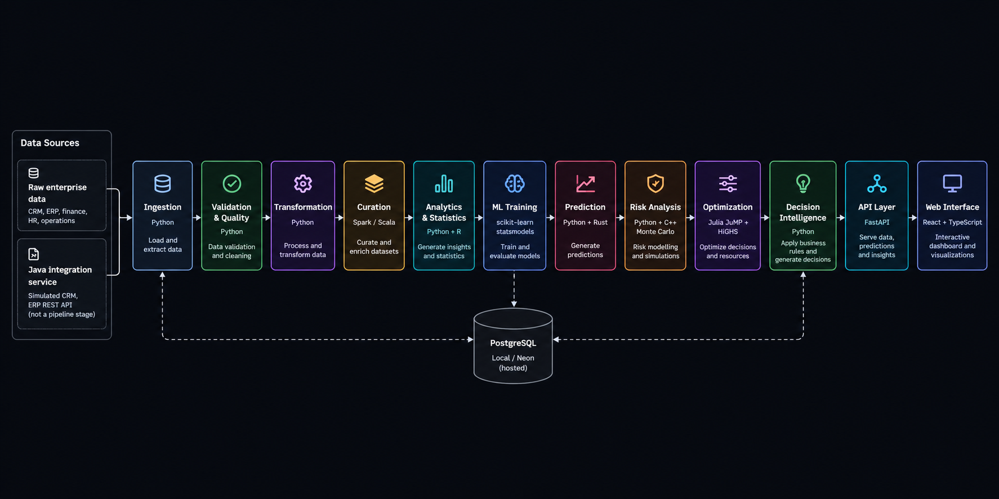
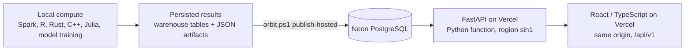

<p align="center">
  
</p>

<h1 align="center">ORBIT ENTERPRISE</h1>

<h3 align="center">End-to-End Enterprise Data &amp; Decision Intelligence Platform</h3>

<p align="center">
  ORBIT ENTERPRISE takes simulated enterprise data from raw sources through validation, distributed curation, statistics, machine learning, risk simulation and optimization, and turns the results into prioritized, evidence-backed decisions. Each recommendation can be traced back to the forecast, model, metric and dataset behind it.
</p>

<p align="center">
  <a href="https://orbit-enterprise.vercel.app"></a>
  
  
  
  
  
  
  <a href="LICENSE"></a>
</p>

<p align="center">
  <a href="https://orbit-enterprise.vercel.app">
    <strong>Live Demo</strong>
  </a>
</p>

---

## Overview

ORBIT ENTERPRISE is an end-to-end enterprise data and decision intelligence platform. It takes simulated enterprise data through data engineering, analytics, machine learning, risk simulation, optimization and decision intelligence, and serves the results through a governed API and web interface.

Every recommendation can be traced back through its forecast, model, metric and dataset. Decisions come from models, statistics, simulation, optimization and a rules engine. ORBIT is a deterministic analytical platform: there is no LLM in the decision path, and it is not a chatbot or an agent system.

## Key Capabilities

### Data Engineering

- Multi-source ingestion (CSV, JSON, Parquet)
- Schema and quality validation with per-dataset scoring
- Quarantine of failing records instead of silent drops
- 11-stage orchestrated pipeline with run IDs and per-stage lineage

### Analytics & Machine Learning

- Revenue forecasting, churn classification, operations anomaly detection and customer segmentation
- Versioned models in a model registry
- Baseline comparisons for every model

### Risk & Optimization

- Region and business-unit risk scoring with named factors, weights and confidence
- C++ Monte Carlo revenue-at-risk (VaR, CVaR)
- Julia JuMP + HiGHS mixed-integer allocation of marketing spend and hires under budget, headcount and risk constraints

### Decision Intelligence

- Rules-based decision engine with prioritized, evidence-backed recommendations
- Traceable "Why?" chain for every recommendation
- Scenario Lab for what-if levers

### Enterprise Interface

- 13-page React application
- URL-persisted filters and global search
- CSV and Markdown exports
- BI exports for Tableau, Power BI and QlikView

## Architecture

<p align="center"></p>

The Java service exposes simulated CRM accounts and ERP suppliers and purchase orders over REST. It runs alongside the platform as an integration endpoint; the orchestrator ingests the same sources from files, so the Java service is not a pipeline stage.

## End-to-End Pipeline

The pipeline executes 11 stages from data ingestion through publishing and decision intelligence.

| # | Stage | Technology | Purpose |
|---|---|---|---|
| 1 | INGEST | Python | Load CSV, JSON and Parquet sources into the raw zone (421,862 records) |
| 2 | VALIDATE | Python | Validate schemas, score quality, quarantine failures |
| 3 | TRANSFORM | Python, pandas | Conform and join sources into staging tables |
| 4 | CURATE | Spark / Scala | Distributed aggregation into curated datasets |
| 5 | ANALYZE | Python + R | KPIs, trends, segmentation and statistical tests |
| 6 | TRAIN | scikit-learn, statsmodels | Train and register versioned forecast, churn, anomaly and segmentation models |
| 7 | PREDICT | Python + Rust | Batch scoring; Rust anomaly scorer benchmarked against Python |
| 8 | RISK | Python + C++ | Risk scores and 200,000-path Monte Carlo revenue-at-risk |
| 9 | OPTIMIZE | Julia (JuMP + HiGHS) | Mixed-integer budget and hiring allocation |
| 10 | DECISION | Python | Prioritized recommendations with evidence references |
| 11 | PUBLISH | PostgreSQL | Load outputs, lineage and model metadata into the warehouse |

## Technology Stack

| Technology | Role in ORBIT ENTERPRISE |
|---|---|
| Python 3.13 (pandas, NumPy, PyArrow) | Orchestration, ingestion, validation, transformation, analytics and the decision engine |
| scikit-learn, statsmodels | Forecasting, churn classification, anomaly detection and segmentation |
| Apache Spark 4 / Scala | Distributed curation and aggregation |
| R | Statistics: paired t-test, ANOVA with Tukey HSD, regression diagnostics, rank correlation |
| Rust | High-performance batch anomaly scoring |
| C++ | Monte Carlo revenue-at-risk simulation |
| Julia (JuMP + HiGHS) | Mixed-integer optimization of budget and hiring |
| Java 21 | Integration service exposing simulated CRM and ERP REST endpoints (JDK only) |
| PostgreSQL 17 / Neon | Warehouse, lineage, model registry and persisted artifacts |
| FastAPI, Pydantic, psycopg 3 | Versioned REST API with a standard response envelope |
| React 18, TypeScript, Vite, Recharts | Web interface |
| Vercel | Hosting for the web app and the API as a Python function |

See [technology rationale](docs/technology-rationale.md) for why each one was chosen.

## Engineering & Model Results

These measurements are engineering demonstrations on the simulated enterprise dataset, not claims of production business performance.

| Metric | Result |
|---|---|
| Revenue forecast (ridge, year-over-year features), test MAPE | 9.0% vs 15.3% for the seasonal naive baseline |
| Churn classifier, test ROC AUC | 0.909 |
| Churn classifier, test PR AUC | 0.721 |
| Operations anomaly detector (Isolation Forest), test | Precision 0.619, recall 0.963, F1 0.754 |
| Rust vs Python scoring, 32,880 rows | About 29x faster in the latest measured run; scores match within 5.5e-7 |
| Optimization vs pro-rata baseline (default parameters) | +7.98%, about 2.13M, status OPTIMAL |

The naive forecast baseline still wins in 4 of 6 regions, and the Forecasts page says so per region.

## Data Quality

Every dataset is scored against these rule families. Failing records are quarantined with the rule that rejected them.

| Check | What it covers |
|---|---|
| Schema | Expected columns and types, with schema-drift detection |
| Completeness | Missing required values |
| Uniqueness | Duplicate keys |
| Validity | Ranges, formats and allowed values |
| Consistency | Agreement between related fields |
| Referential integrity | Foreign keys that resolve to known entities |

## Model Intelligence

- Versioned model artifacts in `ml/artifacts`
- Model registry in `model_runs` with parameters, test metrics and baselines
- Prediction metadata linking every prediction to its model version
- Model Intelligence page comparing each model with its baseline

Every recommendation carries a traceable "Why?" chain:

```
recommendation > forecast > model output > metric > dataset
```

## Testing

| Test Area | Result |
|---|---|
| pytest (unit, API contract, live database, Julia, publish round trip, ID endpoints) | 138 passed |
| Java integration SelfTest | 21/21 passed |
| Rust | 2/2 passed |
| Vitest (components, states, filters, branding) | 26 passed |
| ESLint | Passing, 0 warnings |
| TypeScript (`tsc --noEmit`) | Passing |
| Production build (Vite) | Passing |
| Playwright on production (desktop, laptop, tablet, mobile) | 20 passed |

The 8 ID-based production endpoints were tested with valid and invalid IDs. Valid IDs are discovered from the live list endpoints, and no error response leaked internal details.

| Endpoint | Valid ID | Invalid ID | Result |
|---|---|---|---|
| `risks/region/{id}` | 200 | 400 | Pass |
| `anomalies/{id}` | 200 | 404 / 422 | Pass |
| `decisions/{id}/trace` | 200 | 404 | Pass |
| `data/quality/{dataset}` | 200 | 404 | Pass |
| `exports/{kind}` | 200 | 422 | Pass |
| `optimization/{id}` | 200 | 404 | Pass |
| `models/{version}` | 200 | 404 | Pass |
| `operations/runs/{id}` | 200 | 404 | Pass |

## Production Architecture



- Vercel serves the web app and the API; Neon persists the results.
- Heavy compute (Spark, Julia, model training) runs outside Vercel on the local workstation.
- The live app reads the persisted results; the hosted Optimization page shows the latest persisted run, and new solves run locally.

## Security

- No secrets committed; database credentials are held only in server-side environment variables
- Same-origin API; CORS rejects unauthorized origins
- CSP, HSTS, X-Frame-Options, nosniff, Referrer-Policy and Permissions-Policy headers
- 32 KB request body limit and per-instance rate limiting
- Sanitized errors without stack traces; a request ID on every API response and structured JSON API logs
- Interactive API docs page disabled in production; the `/api/v1/openapi.json` schema remains public

## Data Notice

> **Data Notice:** ORBIT uses a simulated enterprise dataset designed to reproduce realistic relationships between customers, transactions, operations, employees, suppliers, risk indicators and business outcomes. Results are demonstrative and should not be interpreted as production business forecasts.

- The dataset is synthetic, produced by a seeded generator.
- No real company, customer or person is represented.
- Model metrics are demonstrative and describe performance on simulated data.
- Optimization response coefficients include planning assumptions rather than estimates from observed outcomes.
- A production deployment would require real enterprise data, recalibrated models and validated coefficients.
- The project demonstrates the architecture, engineering workflow and analytical methodology, not real-world business performance.

## Limitations

- The dataset is synthetic and optimization coefficients include planning assumptions (see Data Notice).
- Heavy compute runs locally; the hosted site serves the latest published run and cannot solve new optimization parameters.
- No authentication: the demo is public and read-mostly. Write endpoints are limited to scenario runs and the optimization request, which does not mutate data when hosted.
- Rate limiting is per function instance, not global.
- Vercel cold starts add latency after idle; the heaviest views take a few seconds.
- BI guides for Tableau, Power BI and QlikView are not tested inside those tools.

## Documentation

The repository is organized around data pipelines, analytics, ML, optimization, decision intelligence, API services, web applications, BI exports and tests.

- Architecture: [Architecture](docs/architecture.md), [Technology rationale](docs/technology-rationale.md), [Data model](docs/data-model.md)
- Data: [Data pipeline](docs/data-pipeline.md), [KPI governance](docs/kpi-governance.md)
- ML and decisions: [ML system](docs/ml-system.md), [Optimization](docs/optimization.md), [Decision intelligence](docs/decision-intelligence.md)
- API: [API](docs/api.md)
- BI: [BI overview](docs/bi/README.md), [Tableau](docs/bi/tableau.md), [Power BI](docs/bi/powerbi.md), [QlikView](docs/bi/qlikview.md)

## Author

**Designed and developed by Shohrab Haque Shahil**

## License

Released under the [MIT License](LICENSE).
