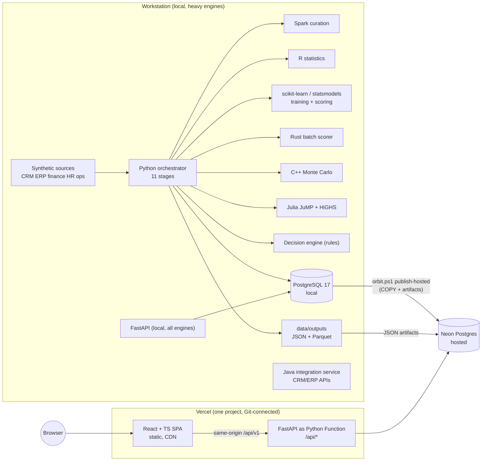

# ORBIT // ENTERPRISE


End-to-end enterprise data and decision intelligence platform: simulated multi-source enterprise data, a staged pipeline with quality gates, Spark curation, statistical analytics, ML models, risk scoring, Monte Carlo simulation, mixed-integer optimization, a rules-based decision engine, a FastAPI backend and a React + TypeScript decision intelligence web app.

- Repository: https://github.com/shahil5z/orbit-enterprise
- Production demo: see [Production Demo](#production-demo)

## Overview

ORBIT answers operational questions ("which regions are at risk, why, and what should we do?") with numbers traced to stored data, model outputs and explicit rules. There is no chatbot and no LLM in the decision path. Every recommendation carries a "Why?" chain: recommendation > forecast > model output > metric > dataset.

All data is synthetic (seeded generator). Metrics describe models trained on simulated data, not real business performance.

## Business Problem

Enterprises keep CRM, ERP, finance, HR and operations data in separate systems. Leaders get dashboards that describe the past but not decisions: where revenue is at risk, which anomalies matter, how to allocate a constrained budget and headcount, and what happens under a scenario. ORBIT joins those sources, scores risk, forecasts, optimizes allocation under constraints and turns the results into prioritized, evidence-backed recommendations.

## Key Capabilities

- Multi-source ingestion (CSV, JSON, Parquet) with schema and quality validation; failing records are quarantined, not dropped silently.
- 11-stage orchestrated pipeline with a run id and per-stage lineage in `pipeline_runs`.
- Revenue forecasting, churn classification, operations anomaly detection and customer segmentation.
- Region and business-unit risk scoring with explicit factors, weights and confidence.
- C++ Monte Carlo revenue-at-risk (VaR, CVaR).
- Julia JuMP + HiGHS mixed-integer allocation of marketing spend and hires.
- Decision engine with prioritized recommendations and evidence references.
- Scenario Lab (demand, cost, capacity, workforce, marketing and churn levers) against a labelled baseline.
- 13-page web app with URL-persisted global filters, global search, CSV and Markdown exports.
- BI exports for Tableau, Power BI and QlikView with a governed KPI catalogue.

## Architecture



The hosted API never recomputes heavy results. It reads what the workstation pipeline persisted. Endpoints that need a local engine (the Julia optimization run) return the latest persisted run with an explicit "runs locally" message.

## Tech Stack

| Layer | Implemented with |
|---|---|
| Pipeline and analytics | Python 3.13, pandas, NumPy, PyArrow, SciPy |
| Curation | Apache Spark 4.0.4 |
| Statistics | R 4.6.1 |
| ML | scikit-learn, statsmodels |
| Batch scoring | Rust |
| Simulation | C++ (g++) |
| Optimization | Julia 1.11.7, JuMP, HiGHS |
| Storage | PostgreSQL 17 (local), Neon Postgres (hosted), Parquet zones |
| API | FastAPI, Pydantic, psycopg 3 |
| Integration service | Java 21 (JDK HttpServer, no third-party deps) |
| Web | React 18, TypeScript 5.9, Vite 6, React Router 7, Recharts |
| Tests | pytest, Vitest, Testing Library, Playwright |
| Hosting | Vercel (static SPA + Python Function), Neon via Vercel Marketplace |

## Data Pipeline

`pipelines/orchestrator.py` runs INGEST, VALIDATE, TRANSFORM, CURATE (Spark), ANALYZE, TRAIN, PREDICT, RISK, OPTIMIZE, DECISION and PUBLISH. Each stage records status, duration, record counts and errors in `data/runs` and `pipeline_runs`. Data zones: raw, staging (with `_quarantine`), curated, outputs. Details: [docs/data-pipeline.md](docs/data-pipeline.md), [docs/data-model.md](docs/data-model.md).

## ML

MEASURED on holdout splits of the simulated data ([docs/ml-system.md](docs/ml-system.md)):
- Revenue forecast per region (ridge on year-over-year features): test MAPE 9.00% vs seasonal naive 15.33%. The naive baseline wins in 4 of 6 regions, and the Forecasts page shows that per region.
- Churn classifier: ROC AUC 0.909, PR AUC 0.721, F1 0.633.
- Operations anomaly (Isolation Forest): precision 0.619, recall 0.963, F1 0.754.
- Customer segmentation: KMeans, k = 4.
- Rust batch scorer matches Python within 5.5e-7, about 24x faster end to end on 32,880 rows.

Models are versioned in `ml/artifacts` and registered in `model_runs`.

## Risk

Risk per region and business unit is a weighted sum of named factors, each with weight, reference and description, mapped to LOW, MEDIUM, HIGH or CRITICAL with a confidence value. C++ Monte Carlo (200k simulations) gives expected revenue, P5/P95, VaR95 and CVaR95. Risk levels are always shown as text, never by colour alone.

## Optimization

Julia JuMP + HiGHS solves a mixed-integer allocation of marketing spend and hires across regions and business units, subject to total budget, hire total, a risk-weighted spend cap and per-region minimum share. MEASURED default run: OPTIMAL, objective +7.98% vs a pro-rata baseline, solve time 0.04 s. Response coefficients are planning assumptions, not estimates (INFERRED risk). Details: [docs/optimization.md](docs/optimization.md).

## Decision Intelligence

`decision/engine.py` combines risk, forecasts, anomalies and optimization results with explicit rules into prioritized recommendations (observation, cause, forecast, risk, recommendation, expected impact, confidence, evidence). The Decision Center shows the full trace for each one. Details: [docs/decision-intelligence.md](docs/decision-intelligence.md).

## Scenario Analysis

The Scenario Lab applies levers (demand, cost, capacity, workforce, marketing budget, churn) to the latest baseline with a transparent model (`decision/scenarios.py`). Outputs are labelled SCENARIO, list their assumptions and show revenue, margin, operating profit, P5 and CVaR95 against the baseline.

## BI Integration

`orbit.ps1 bi-export` writes CSV datasets and `schema.json` into `data/bi` (gitignored). Guides for Tableau, Power BI and QlikView are in [docs/bi](docs/bi), and the governed KPI definitions are in [docs/kpi-governance.md](docs/kpi-governance.md). The guides are NOT TESTED against the BI tools themselves (none are installed).

## Structure

```
api/index.py            Vercel Python Function entrypoint (wraps apps/api)
apps/api/orbit_api      FastAPI: routes, services, repository, security middleware
apps/web                React + TypeScript SPA (src/features/<page>, src/components/ui, e2e/)
analytics/              python, r, rust (anomaly_scorer), cpp (Monte Carlo), julia (allocation model)
pipelines/              ingestion (incl. synthetic generator), validation, transformation, spark, orchestrator
ml/                     forecasting, classification, anomaly_detection, risk, evaluation
decision/ optimization/ decision engine, scenarios, optimization workflow
database/               migrations, views, seeds (load.py, publish.py)
services/java           CRM/ERP integration service
bi/ docs/ tests/        BI export, documentation, pytest suites
scripts/                env.ps1, orbit.ps1 (all commands)
vercel.json             build, function, rewrites and security headers
```

## Local Setup

Windows PowerShell, from the project root. All tools live in `.tools\` (gitignored); nothing is installed system-wide.

```powershell
. .\scripts\env.ps1                 # portable tools from .tools on PATH
.\scripts\orbit.ps1 install         # Python venv + requirements-dev.txt
.\scripts\orbit.ps1 db-start        # portable PostgreSQL 17 on port 55432
.\scripts\orbit.ps1 migrate; .\scripts\orbit.ps1 seed
.\scripts\orbit.ps1 pipeline        # all 11 stages (add -Regenerate for fresh data)
.\scripts\orbit.ps1 api             # FastAPI on http://127.0.0.1:8000/api/v1
.\scripts\orbit.ps1 web-install     # npm install (cache in .tools) + Playwright chromium into .tools
.\scripts\orbit.ps1 web-dev         # Vite dev server (proxies /api to :8000)
.\scripts\orbit.ps1 java            # Java integration service on :8081
```

Do not pipe these commands through `2>&1` in Windows PowerShell 5.1: native stderr warnings become terminating errors.

## Env Vars

Copy `.env.example` to `.env` (gitignored). `.env.example` contains placeholders only.

| Variable | Where | Purpose |
|---|---|---|
| `ORBIT_ENV` | all | `local` (all engines), `dev`, `prod` (hosted, persisted results only) |
| `DATABASE_URL` / `ORBIT_DATABASE_URL` | server only | Full Postgres URL; wins over the discrete fields. Set by the Neon integration on Vercel. |
| `ORBIT_DB_HOST`, `_PORT`, `_NAME`, `_USER`, `_PASSWORD` | local | Local Postgres |
| `ORBIT_CORS_ORIGINS` | server | Comma-separated origins. Defaults to `http://localhost:5173` only when `local`; empty otherwise (same origin). |
| `ORBIT_LOCAL_ENGINES` | server | Defaults to false in `prod`; enables the Julia run endpoint when true |
| `ORBIT_RATE_LIMIT_PER_MIN`, `ORBIT_MAX_BODY_BYTES` | server | Per-client request budget (default 600/min per instance) and body limit (32 KB) |
| `ORBIT_TARGET_DATABASE_URL` | shell only | Target for `orbit.ps1 publish-hosted` |
| `VITE_API_BASE_URL` | client (public) | Optional API origin. Unset in production: the SPA calls same-origin `/api/v1`. |

In `prod` the API refuses to start if CORS or the database URL points at a loopback host. Secrets never go into client code: the only client-exposed variable is the public API base.

## Testing

```powershell
.\scripts\orbit.ps1 test        # pytest (unit, API contract, live DB integration, Julia, publish round trip)
.\scripts\orbit.ps1 web-test    # eslint + tsc + vitest
.\scripts\orbit.ps1 web-build   # production build
.\scripts\orbit.ps1 e2e         # Playwright: desktop 1440, laptop 1280, tablet 820, mobile 390
```

`ORBIT_WEB_URL=<url> npx playwright test` runs the same journeys against any deployment. In hosted mode the optimization journey asserts the "runs locally" notice instead of a solve.

## Deployment Architecture

- One Vercel project, Git-connected to this repository; every push to `main` deploys production.
- `vercel.json`: installs and builds `apps/web` (static output `apps/web/dist`), deploys `api/index.py` as a Python 3.13 Function, rewrites `/api/*` to it and everything else to `index.html` (SPA deep links), and sets security headers (CSP, HSTS, X-Frame-Options, nosniff, Referrer-Policy, Permissions-Policy).
- The API adds its own headers, a 32 KB body limit, an in-process rate limit, sanitized errors (no stack traces) and disables `/docs` in prod.
- Hosted Postgres: Neon (free tier) via the Vercel Marketplace; `DATABASE_URL` is a server-side environment variable.
- Seeding: `orbit.ps1 publish-hosted` copies every table from the local database in FK order (COPY streaming) and upserts the JSON artifacts into `artifacts`. Idempotent.

## Production Demo

Production URL: first Git-connected deployment in progress (Vercel, region sin1, Neon Postgres in Singapore). URL added after verification.

## Engineering Decisions

- Heavy engines stay local; the hosted tier serves persisted results. This keeps the function small (API runtime deps only, see `requirements.txt`) and avoids faking compute that cannot run on serverless.
- Same-origin API: no CORS surface in production and no API URL secrets in the bundle.
- Artifacts in Postgres (`artifacts` table) instead of a file store, so one hosted dependency serves the whole API.
- Only `apps/web/src/services/http.ts` may call `fetch` (ESLint rule), so error handling and timing are uniform.
- Rules-based decisions with evidence over generated text: every claim is traceable.
- Exact dependency pins; vulnerable packages upgraded only when an audit flagged them.

## Limitations

- Synthetic data only; model metrics do not transfer to real data.
- No authentication: the demo is read-mostly and public. Write endpoints are limited to scenario runs and the optimization request, which is non-mutating when hosted.
- The rate limiter is per function instance, not global.
- Hosted optimization cannot solve new parameters; it returns the latest persisted run.
- Cold starts of the Python Function (pandas import) add latency on the first request after idle.
- BI guides are NOT TESTED in the BI tools.
